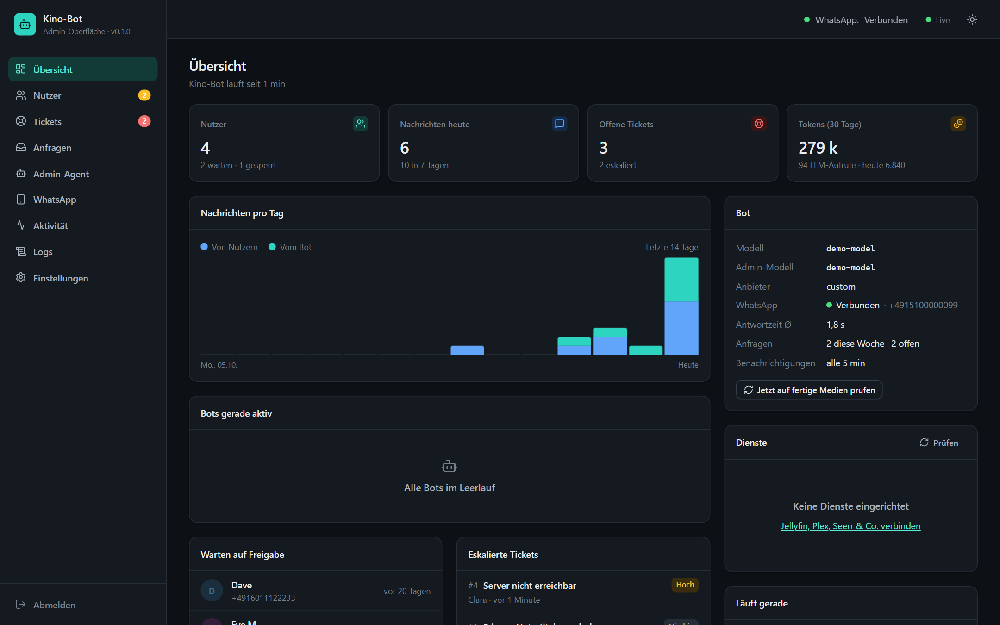
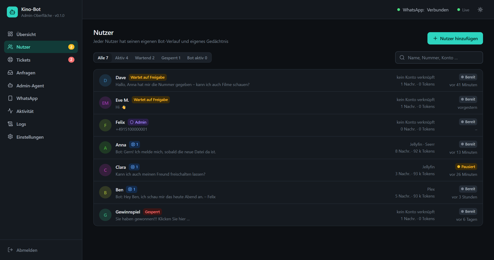
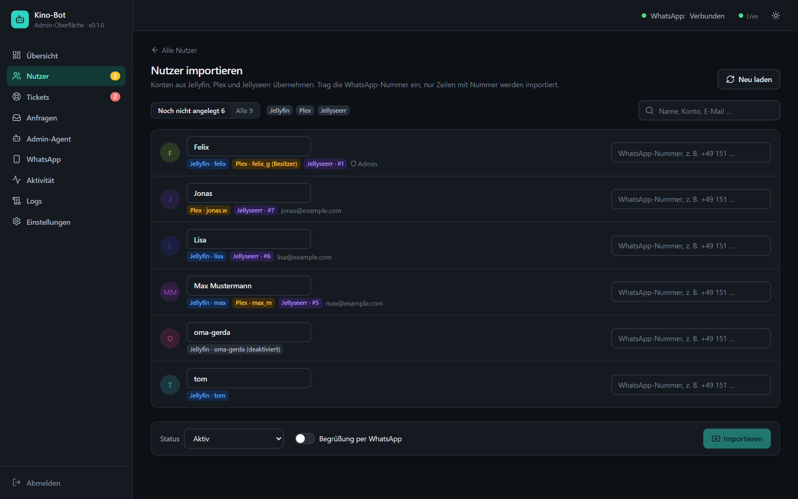
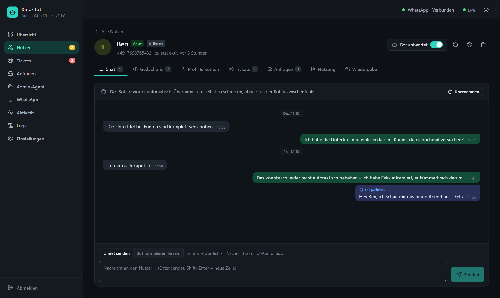
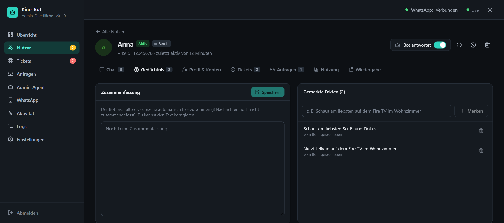
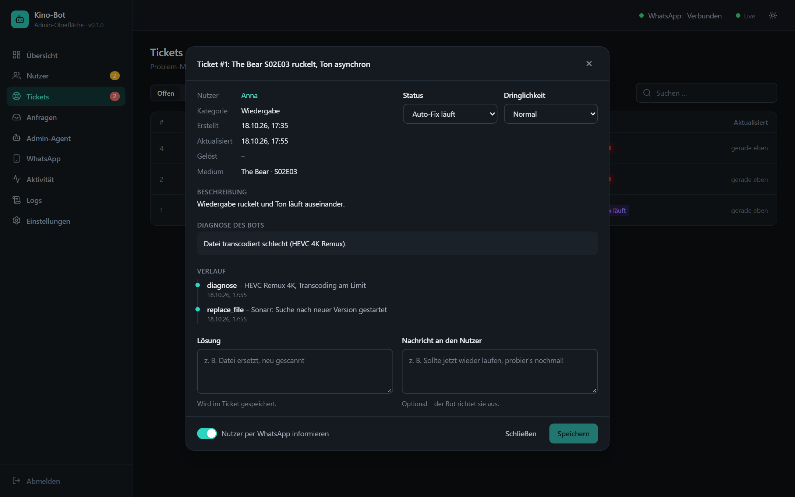
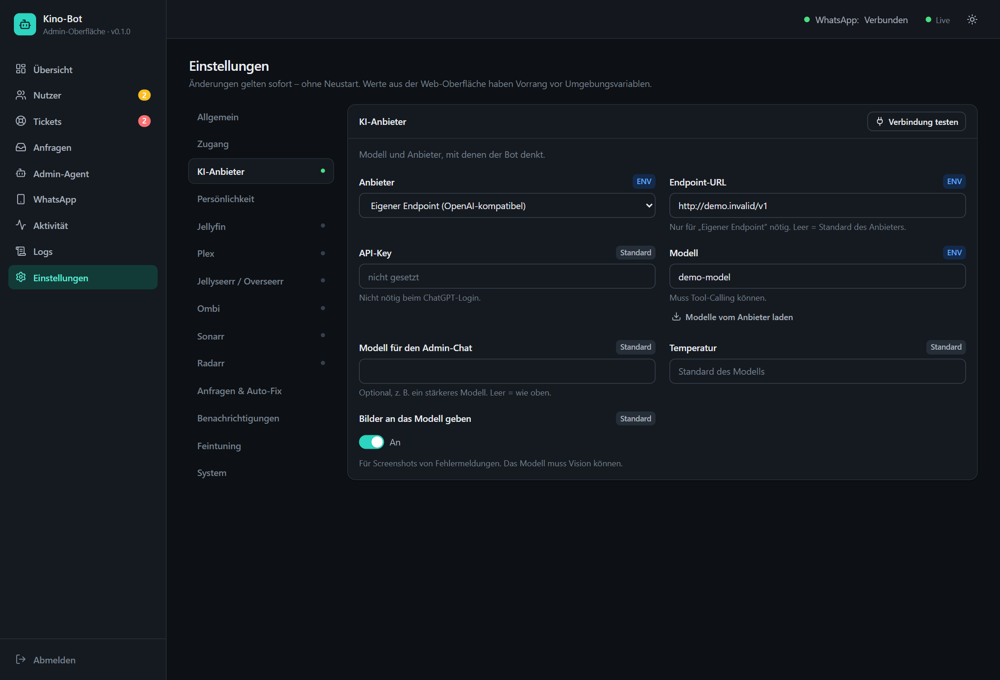
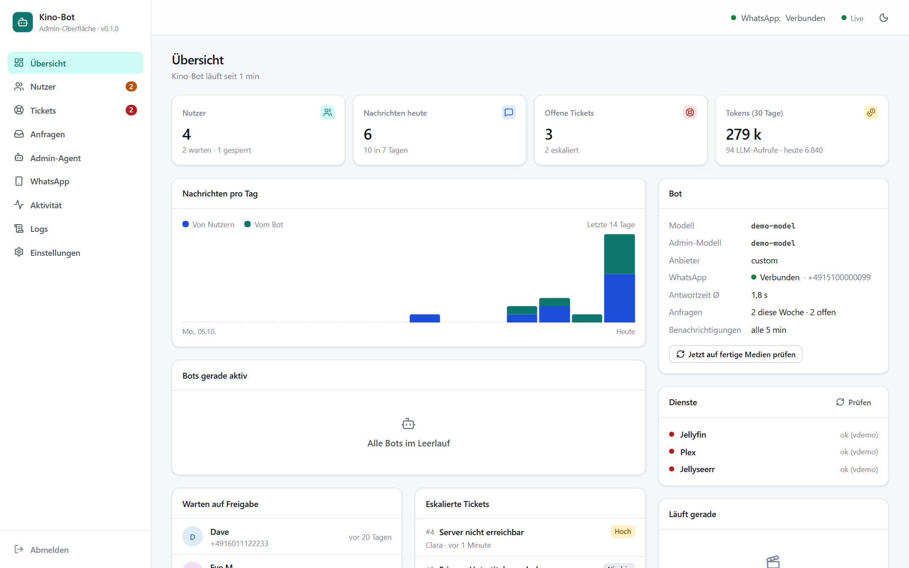
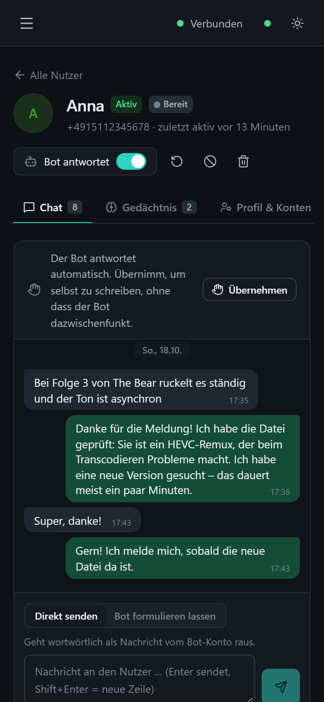

<p align="center">
  
</p>

<h1 align="center">Media Agentcy</h1>

<p align="center">
  <b>WhatsApp-KI-Assistent für die Nutzer deines Jellyfin-/Plex-Servers</b><br>
  Nimmt Wünsche an, meldet Fertiges, behebt kleine Medienfehler selbst und holt dich nur, wenn's wirklich brennt.
</p>

<p align="center">
  <a href="#installation-auf-unraid">Unraid-Installation</a> ·
  <a href="#web-oberfläche">Web-Oberfläche</a> ·
  <a href="#docker-run--docker-compose">docker run / compose</a> ·
  <a href="#entwicklung">Entwicklung</a>
</p>



## Was der Bot kann

| | |
|---|---|
| 🎬 **Medienwünsche** | „Kannst du Dune 2 besorgen?“ → Suche über Jellyseerr/Overseerr oder Ombi, der Bot schickt Cover, Titel und Erscheinungsdatum und fragt erst nach einem „Ja“ an (keine Anfragen für den falschen Film), Anfrage im Namen des Nutzers, Tageslimit pro Nutzer |
| 🔍 **Anfragen nachverfolgen** | „Was ist mit meiner Anfrage?“ → der Bot prüft Jellyseerr, Radarr/Sonarr und die Mediathek, erklärt in einfachen Worten, wo es hängt, und hilft gleich: neu suchen, Mediathek neu einlesen, Anfrage wiederholen oder den Admin erinnern (mit Sperrfrist gegen Dauerschleifen) |
| 🔔 **Benachrichtigungen** | Sobald eine Anfrage verfügbar ist, bekommt der Nutzer eine persönliche WhatsApp, auch für Anfragen von der Jellyseerr-Webseite. Die Nachricht sagt nur „jetzt verfügbar“, ohne Jellyfin und Plex zu unterscheiden |
| ⏳ **Hängende Anfragen** | Liegt eine Anfrage länger als 3 Tage, prüft der Bot sie selbst und stößt an, was er kann (neu suchen, Mediathek einlesen, Anfrage wiederholen). Du bekommst eine Sammelnachricht: was er angestoßen hat und was dich braucht |
| 🌐 **Webseiten-Anfragen zuordnen** | Anfragen von der Jellyseerr-/Ombi-Webseite landen automatisch beim richtigen Nutzer (über Jellyseerr-ID, Jellyfin-, Plex- oder Ombi-Name) und erscheinen unter *Anfragen*. Schon Fertiges wird still abgelegt, Wartendes gemeldet, sobald es da ist |
| 🎟️ **Zugang einrichten** | Beim Freischalten legt der Bot auf Wunsch ein Jellyfin-Konto an, übernimmt es nach Jellyseerr und schickt dem Nutzer Benutzername, Passwort und App-Anleitung per WhatsApp. Das Passwort geht nie durch die KI |
| 🚧 **Störungen & Wartung** | Ist Jellyfin oder Plex nicht erreichbar, merkt der Bot das, sagt dir Bescheid und beantwortet Nutzer mit einem festen Hinweis statt Tickets und Diagnosen. Wartung kündigst du per Klick oder im Admin-Chat an. Danach bekommen alle Betroffenen eine Entwarnung |
| 📬 **Wochenrückblick** | Einmal pro Woche „Neu auf dem Server“: neue Filme und Folgen als feste Nachricht ohne KI-Kosten. Nutzer bestellen ihn mit „Wochenrückblick aus“ ab |
| 🎙️ **Sprachnachrichten** | Sprachnachrichten werden über einen Whisper-Endpoint (Groq, OpenAI oder lokal) in Text umgewandelt, der Bot antwortet ganz normal |
| 🛡️ **Missbrauchsschutz** | Der Bot bleibt beim Thema Mediaserver. Hausaufgaben, Texte, Code und Co. lehnt er ab, nach 3 Versuchen pausiert er für die Person bis zu 24 h und sagt dir Bescheid. Dazu Tageslimits für Nachrichten und Tokens und eine Längenbegrenzung für eingefügte Texte |
| 🛠️ **Problemmeldungen** | Ticket → Diagnose über Radarr/Sonarr/Jellyfin/Plex → kleine Fehler selbst beheben (Datei ersetzen, fehlende Folgen suchen, Rescan, Metadaten) → Nutzer informieren, wenn die neue Datei da ist |
| 🚨 **Eskalation** | Größere Probleme gehen per WhatsApp an dich. Du sprichst im selben Chat mit dem Agenten, er richtet den Nutzern deine Antworten aus |
| 🤖 **Hermes Agent** | Ernste Probleme („Streaming geht nicht mehr“) und erkannte Ausfälle gibt der Bot an deinen [Hermes Agent](https://hermes-agent.nousresearch.com) weiter. Hermes sucht die Ursache, repariert und meldet sich zurück. Der Bot sagt dem Nutzer Bescheid, du bekommst jeden Zwischenstand per WhatsApp |
| 🧠 **Gedächtnis pro Nutzer** | Fakten (Geräte, Vorlieben …), laufende Zusammenfassung früherer Gespräche, Ticket- und Anfrageverlauf |
| 👥 **Nutzer-Import** | Konten aus Jellyfin, Plex und Jellyseerr auf einen Blick, zusammengeführt pro Person. WhatsApp-Nummer eintragen, importieren, fertig verknüpft |
| 🖥️ **Web-Oberfläche** | Nutzer freischalten, Chats mitlesen und übernehmen, Tickets, Token-Verbrauch, alle Einstellungen live, am Handy und am Desktop |
| 🔌 **KI frei wählbar** | OpenRouter, OpenAI, ChatGPT-Login (experimentell) oder jeder OpenAI-kompatible Endpoint (Ollama, LM Studio, LiteLLM …) |

## Screenshots

<table>
  <tr>
    <td width="50%"><br><sub><b>Nutzer:</b> Status, verknüpfte Konten, Live-Status jedes Bots</sub></td>
    <td width="50%"><br><sub><b>Import:</b> Konten aus Jellyfin, Plex und Jellyseerr übernehmen, Handynummer dazu</sub></td>
  </tr>
  <tr>
    <td><br><sub><b>Chat:</b> Verlauf wie in WhatsApp, Bot pausieren und selbst schreiben</sub></td>
    <td><br><sub><b>Gedächtnis:</b> Zusammenfassung und Fakten pro Nutzer, bearbeitbar</sub></td>
  </tr>
  <tr>
    <td><br><sub><b>Tickets:</b> Diagnose, was der Bot schon versucht hat, Lösung setzen</sub></td>
    <td><br><sub><b>Einstellungen:</b> alles ohne Neustart, mit Verbindungstest und Modell-Liste</sub></td>
  </tr>
  <tr>
    <td colspan="2" align="center"><br><sub><b>Hell oder dunkel:</b> folgt dem System, umschaltbar</sub></td>
  </tr>
</table>

<p align="center">
  <br>
  <sub>Funktioniert auch auf dem Handy</sub>
</p>

## Installation auf Unraid

### Was du brauchst

- **Eine eigene WhatsApp-Nummer für den Bot** (Zweit-SIM oder eSIM, WhatsApp Business geht auch). Die Nummer wird wie WhatsApp Web als „verknüpftes Gerät“ angemeldet.
- **Einen KI-Anbieter mit Tool-Calling**, z. B. einen [OpenRouter-API-Key](https://openrouter.ai/keys) oder ein lokales Ollama mit einem passenden Modell.
- Optional die API-Keys deiner Dienste: Jellyfin, Plex, Jellyseerr/Overseerr, Ombi, Sonarr, Radarr ([wo du sie findest](#api-keys)).

### 1. Template herunterladen

Im Unraid-Webinterface oben rechts das Terminal öffnen (`>_`) und ausführen:

```bash
wget -O /boot/config/plugins/dockerMan/templates-user/my-media-agentcy.xml https://git.felix-cloud.net/root/media-agentcy/-/raw/master/unraid/media-agentcy.xml
```

### 2. Container anlegen

**Docker** → **Add Container** → oben bei **Template** unter *User templates* `media-agentcy` auswählen.

| Feld | Wert | Hinweis |
|---|---|---|
| Web-Oberfläche (Port) | `8085` | Host-Port für Oberfläche, QR-Code und Webhook |
| Daten | `/mnt/user/appdata/media-agentcy` | Datenbank, WhatsApp-Login, Einstellungen. Gehört ins Backup |
| Admin-Nummer(n) | `4917612345678` | Deine Nummer, mit Ländervorwahl, ohne `+` |
| Web-Passwort | *(leer oder eigenes)* | Leer = zufälliges Passwort im Log |
| KI-Anbieter / API-Key / Modell | `openrouter` / `sk-or-…` / `openai/gpt-4.1-mini` | Geht auch später in der Oberfläche |

Unter **Show more settings** gibt es noch Endpoint-URL (für Ollama & Co.), Zeitzone, HTTP-Token und Log-Level.

Alle Felder außer Port und Datenordner sind optional: Der Container startet auch leer, den Rest stellst du in der Oberfläche ein. **Apply** klicken.

### 3. Web-Oberfläche öffnen

Im Docker-Tab auf das Icon → **WebUI**, oder direkt `http://<unraid-ip>:8085`.

Hast du kein Web-Passwort gesetzt, steht das erste Passwort im Log:

```bash
docker logs media-agentcy 2>&1 | grep "Erstes Passwort"
```

Ändern kannst du es danach unter **Einstellungen → System**.

### 4. WhatsApp verbinden

In der Oberfläche auf **WhatsApp** gehen und den QR-Code mit dem **Bot-Handy** scannen: WhatsApp → *Verknüpfte Geräte* → *Gerät hinzufügen*. Der Login bleibt im Datenordner gespeichert, auch über Updates hinweg.

### 5. Dienste einrichten

Unter **Einstellungen** KI-Anbieter (mit *Verbindung testen*), Jellyfin/Plex, Jellyseerr/Overseerr, Ombi, Sonarr und Radarr eintragen. Werte gelten sofort, ohne Neustart. Nicht eingetragene Dienste ignoriert der Bot einfach.

Als URLs funktionieren die internen Adressen, z. B. `http://192.168.1.10:8096` für Jellyfin. Läuft alles im selben Docker-Netz, gehen auch Containernamen.

### 6. Loslegen

1. Schreib dem Bot von deiner Admin-Nummer „Hi“. Du wirst automatisch als Admin angelegt.
2. Schreibt eine neue Nummer, bekommst du „🆕 Neue Nummer …“ per WhatsApp, und sie erscheint in der Oberfläche unter **Nutzer**.
3. Freischalten per Klick oder im Admin-Chat, z. B. *„Schalte #2 frei, das ist Max, Jellyfin-User max“*. Der Agent schaltet frei, verknüpft Jellyfin- und Jellyseerr-Konto und begrüßt Max.
4. Hat die Person noch kein Konto: *„Schalte #3 frei und leg ihr ein Jellyfin-Konto an“* oder im Nutzer-Detail **Jellyfin-Konto anlegen**. Der Bot erstellt das Konto, übernimmt es nach Jellyseerr und schickt die Zugangsdaten samt App-Anleitung per WhatsApp. Mit **Einstellungen → Neue Nutzer → Jellyfin-Konto automatisch anlegen** passiert das bei jeder Freischaltung. Legst du jemanden selbst unter **Nutzer → Nutzer hinzufügen** an, gibt es dafür einen Schalter im Dialog (standardmäßig an): Konto, Zugangsdaten und Begrüßung gehen dann sofort raus.

**Oder alle auf einmal importieren:** **Nutzer** → **Aus Medienserver importieren**. Die Seite listet alle Konten aus Jellyfin, Plex und Jellyseerr. Konten derselben Person werden zusammengeführt (über Jellyseerr, Benutzername oder E-Mail). Du trägst nur noch die WhatsApp-Nummern ein (mit Ländervorwahl, z. B. `+49 151 …`) und klickst **Importieren**. Optional schreibt der Bot jedem eine kurze Begrüßung. Ist eine Nummer schon angelegt, werden nur die Konten verknüpft. Plex-Nutzer kommen von plex.tv (dein Konto und die Freunde, mit denen du den Server teilst).

Verknüpfte Konten lohnen sich: Anfragen laufen dann im Namen des Nutzers, Anfragen von der Jellyseerr-Webseite werden auch gemeldet, und die Wiedergabe-Diagnose sieht die Sessions des Nutzers.

### Updates

Im Docker-Tab **Check for Updates** → **apply update**. Oder im Terminal:

```bash
docker pull registry.felix-cloud.net/root/media-agentcy:latest
```

…und den Container danach im Docker-Tab neu erstellen lassen (Container anklicken → *Edit* → *Apply*). Daten und WhatsApp-Login bleiben erhalten.

### Optional: Jellyseerr-Webhook

Ohne Webhook prüft der Bot alle 5 Minuten, ob Anfragen fertig sind. Mit Webhook kommt die Nachricht sofort:

Jellyseerr → *Einstellungen → Benachrichtigungen → Webhook* → URL `http://<unraid-ip>:8085/webhook/seerr` (mit `?token=…`, falls ein HTTP-Token gesetzt ist), Ereignis *Medien verfügbar*.

### Optional: Hermes Agent

Ernste Probleme kann der Bot an deinen [Hermes Agent](https://hermes-agent.nousresearch.com) übergeben:

```
Nutzer: „TV geht gar nicht mehr“ → Bot: Ticket, Diagnose, Eskalation (Schwere „hoch“)
   ├─► du: WhatsApp „🚨 Ticket #12 … 🤖 An Hermes übergeben“
   └─► Hermes-Webhook (signiert) → Hermes sucht und repariert
          └─► POST /webhook/hermes {"status":"fixed", …}
                 ├─► Nutzer: „Ist behoben, probier's nochmal“ (Ticket gelöst)
                 └─► du: „✅ Hermes hat Ticket #12 gelöst: …“
```

Automatisch übergeben werden eskalierte Tickets ab der eingestellten Schwere (Standard: *hoch*) und erkannte Ausfälle von Jellyfin/Plex. Andere Tickets übergibst du in der Oberfläche (Ticket öffnen → *An Hermes übergeben*) oder im Admin-Chat („Gib Ticket 7 an Hermes“). Meldet sich Hermes nach 6 Stunden nicht, erinnert dich der Bot.

**1. Route in Hermes anlegen.** In `~/.hermes/config.yaml` (die Werkzeuge lassen sich nur hier freigeben, nicht per `hermes webhook subscribe`):

```yaml
platforms:
  webhook:
    enabled: true
    extra:
      host: 0.0.0.0          # vom Bot-Container aus erreichbar
      port: 8644
      routes:
        media-agentcy:
          secret: "<langes zufälliges Secret>"
          events: ["ticket", "outage"]
          prompt: "{task}"
          toolsets: ["debugging", "skills", "memory"]   # Terminal + Dateien, damit Hermes nachsehen und sich zurückmelden kann
          deliver: "log"     # oder z. B. telegram, wenn du Hermes' ausführlichen Bericht zusätzlich dort willst
```

Ohne `toolsets` bekommen Webhook-Sitzungen in Hermes nur Websuche. Dann kann Hermes weder auf den Server schauen noch sich beim Bot zurückmelden. Hermes startet neu, danach prüft `curl http://<hermes-ip>:8644/health` die Erreichbarkeit.

**2. Im Bot eintragen.** Einstellungen → *Hermes Agent*:
- Webhook-URL: `http://<hermes-ip>:8644/webhooks/media-agentcy`
- Secret: das aus der Route
- Adresse dieses Bots: `http://<unraid-ip>:8085`. Unter dieser Adresse meldet sich Hermes zurück.

**Was Hermes bekommt:** eine Aufgabenbeschreibung mit Ticket, Diagnose des Bots, bisherigen Versuchen und den internen Adressen deiner Dienste (ohne API-Keys und ohne Telefonnummern), außerdem einen `curl`-Befehl mit einem Schlüssel, der nur für diese eine Übergabe gilt. Hermes meldet `working` (Zwischenstand), `fixed`, `failed` oder `needs_admin`, optional mit einem Satz für den Nutzer.

Damit Hermes etwas reparieren kann, braucht er Zugriff auf den Server (z. B. SSH oder Docker). Wie viel er darf, legst du in Hermes fest. Lass die Freigabe für gefährliche Befehle dort an: Der Text des Nutzers steht zwar als „nur Information“ markiert in der Aufgabe, bleibt aber fremder Text.

### API-Keys

| Dienst | Wo |
|---|---|
| Jellyfin | Dashboard → API-Schlüssel → `+` |
| Plex | [X-Plex-Token finden](https://support.plex.tv/articles/204059436) |
| Jellyseerr / Overseerr | Einstellungen → Allgemein → API-Schlüssel |
| Ombi | Einstellungen → Ombi → API-Key |
| Sonarr / Radarr | Settings → General → API Key |
| OpenRouter | [openrouter.ai/keys](https://openrouter.ai/keys), Modelle mit Tool-Calling: [Liste](https://openrouter.ai/models?supported_parameters=tools) |

## docker run / docker compose

Ohne Unraid-Template, auf jedem Docker-Host:

```bash
docker run -d --name media-agentcy --restart unless-stopped -p 8085:8080 -v /mnt/user/appdata/media-agentcy:/data -e TZ=Europe/Berlin registry.felix-cloud.net/root/media-agentcy:latest
```

Oder als `docker-compose.yml`:

```yaml
services:
  media-agentcy:
    image: registry.felix-cloud.net/root/media-agentcy:latest
    container_name: media-agentcy
    restart: unless-stopped
    ports:
      - "8085:8080"
    volumes:
      - /mnt/user/appdata/media-agentcy:/data
    environment:
      TZ: Europe/Berlin
      # ADMIN_NUMBERS: "4917612345678"
      # LLM_API_KEY: "sk-or-..."
```

Alle Optionen, die per Umgebungsvariable gehen, stehen in [`.env.example`](.env.example). Die `docker-compose.yml` im Repo baut das Image aus dem Quellcode und liest eine `.env`:

```bash
cp .env.example .env
docker compose up -d --build
```

## Web-Oberfläche

- **Übersicht**: WhatsApp-Status, aktive Bots, wartende Nutzer, eskalierte Tickets, Nachrichten- und Token-Verbrauch, Zustand der Dienste, was gerade läuft. Dazu die Karte *Störungen & Wartung*: erkannte Ausfälle sehen, Wartungshinweis mit Dauer setzen, aufheben und Entwarnung schicken
- **Nutzer**: alle Nummern mit Status (wartet / aktiv / gesperrt) und Live-Status des jeweiligen Bots (antwortet, sammelt Nachrichten, pausiert, Fehler). Freischalten, sperren, löschen, anlegen
- **Nutzer importieren**: Konten aus Jellyfin, Plex und Jellyseerr übernehmen, pro Person zusammengeführt, WhatsApp-Nummer eintragen. Bestehende Nutzer werden erkannt und nur verknüpft
- **Nutzer-Detail**: Chatverlauf wie in WhatsApp, Gedächtnis (Zusammenfassung und Fakten bearbeiten), verknüpfte Konten, Tickets, Anfragen, Token-Verbrauch, laufende Wiedergabe
- **Übernehmen**: Den Bot eines Nutzers pausieren und selbst schreiben (geht wörtlich vom Bot-Konto raus), oder den Bot deine Nachricht formulieren lassen. Eingehende Nachrichten werden weiter gespeichert, aber nicht beantwortet
- **Tickets**: Status, Dringlichkeit, Lösung setzen und den Nutzer optional per WhatsApp informieren
- **Anfragen**: alles, was über den Bot oder auf der Jellyseerr-/Ombi-Webseite angefragt wurde, mit Nutzer und Status. Webseiten-Anfragen werden bei jeder Prüfung (alle 5 min) automatisch übernommen, *Jetzt abgleichen* holt sie sofort
- **Missbrauchsschutz**: Beim Nutzer unter *Nutzung* siehst du die Zähler der letzten 24 h. Ist der Bot für jemanden pausiert, steht das im Chat, und *Limits aufheben* gibt ihn wieder frei
- **Admin-Agent**: derselbe Admin-Chat wie per WhatsApp, plus Rundnachricht an alle
- **WhatsApp**: QR-Code scannen, neu verbinden, abmelden
- **Aktivität & Logs**: Aktionsprotokoll des Bots und Live-Logs
- **Einstellungen**: alle Optionen aus `.env`, live übernommen

Ein in der Oberfläche gesetzter Wert hat Vorrang vor Umgebungsvariablen. „Zurücksetzen“ an einem Feld nimmt wieder den Wert aus der Umgebung bzw. den Standard. API-Keys gibt die Oberfläche nie zurück, sie zeigt nur die letzten vier Zeichen.

> [!IMPORTANT]
> Die Oberfläche ist fürs Heimnetz gedacht. Von außen nur über VPN oder einen Reverse Proxy mit HTTPS erreichbar machen.

### Beispiele im Admin-Chat

- „Was ist mit Ticket 4?“ / „Welche Tickets sind offen?“
- „Sag Max, dass ich das am Wochenende fixe“
- „Ticket 4 ist erledigt, Festplatte war voll“
- „Wie gesund ist das System?“
- „Was weißt du über Lisa?“ / „Merk dir bei Lisa: nutzt einen Fire TV Stick“
- „Schick allen: Heute 22 Uhr Wartung, ca. 30 min“
- „Limits von Max zurücksetzen“
- „Leg Lisa ein Jellyfin-Konto an“
- „Heute Abend Wartung bis ca. 23 Uhr, Festplattentausch“ / „Wartung ist vorbei“
- „Zeig mir den Wochenrückblick“ / „Schick den Wochenrückblick jetzt raus“
- „Gib Ticket 7 an Hermes, schau mal nach dem Transcoding“

Befehle ohne KI: `/hilfe`, `/reset` (Verlauf leeren), `/status` (Admin: Dienste prüfen).

## So funktioniert's

```
WhatsApp (Baileys) ──► Router ──► Agent (LLM + Tools) ──► Jellyfin · Plex · Jellyseerr · Ombi · Sonarr · Radarr
   ▲                    │  ├─ Zugangskontrolle (neue Nummern → Admin)      │
   │                    │  ├─ bündelt Nachrichten, 1 Warteschlange/Nutzer   ▼
   │                    │  └─ Nutzer-Agent  |  Admin-Agent           SQLite: Nutzer, Gedächtnis, Tickets,
   └──── Antworten ◄────┘                                            Anfragen, Auto-Fix-Watches
Poller (alle 5 min): Erreichbarkeit, fertige Anfragen, Auto-Fix-Ergebnisse, hängende Anfragen, Wochenrückblick
Web-Oberfläche ──► dieselbe Datenbank, Live-Events, Einstellungen (überlagern die Umgebung)
```

Der **Nutzer-Agent** darf nur für sich selbst handeln: suchen, anfragen (erst nach bestätigtem Cover, Tageslimit), Tickets anlegen, diagnostizieren, `fix_media` (Ersetzen höchstens einmal pro Ticket und mit Tageslimit), eskalieren, eigenes Gedächtnis pflegen.

Der **Admin-Agent** (deine Nummer) kann zusätzlich Nutzer freischalten, sperren und verknüpfen, Tickets verwalten, Nutzern Nachrichten ausrichten, Rundnachrichten schicken, den Systemzustand prüfen und das Gedächtnis aller Nutzer lesen.

## Sicherheit und Grenzen

- Nutzer-Agent und Admin-Agent sind getrennt. Was ein Agent darf, hängt an der Absendernummer, nicht am Text der Nachricht. Prompt-Injection von Nutzern bekommt deshalb keinen Zugriff auf Admin-Tools.
- **Missbrauchsschutz** (Einstellungen → *Missbrauchsschutz*, gilt nicht für Admins, 0 = aus): themenfremde Anfragen bis zur Pause (`OFF_TOPIC_LIMIT`, Standard 3), Nachrichten pro Tag (`MESSAGES_PER_DAY`, 60), Tokens pro Tag (`TOKENS_PER_DAY`, 500.000) und Zeichen pro Nachricht (`MAX_MESSAGE_CHARS`, 1500). Während einer Pause kostet der Bot nichts: Nachrichten werden nur gespeichert, die Person bekommt einmal einen festen Hinweis.
- `replace_file` löscht die aktuelle Datei, bevor neu gesucht wird. Das ist abschaltbar (`AUTOFIX_REPLACE_FILE=false`), läuft höchstens einmal pro Ticket und unterliegt einem Tageslimit. Findet sich nach 72 h nichts, geht es automatisch an dich.
- Beim **Kontoanlegen** erzeugt der Bot ein zufälliges Passwort und schickt es direkt per WhatsApp. Es landet weder bei der KI noch in der Oberfläche, im Verlauf steht nur `••••••`. Der Nutzer sollte es in Jellyfin ändern.
- **Sprachnachrichten** gehen an den eingestellten Transkriptions-Dienst (Einstellungen → *Sprachnachrichten*), und zwar erst, nachdem die Nummer als freigeschalteter Nutzer erkannt wurde. Mit einem lokalen faster-whisper-Server verlassen sie dein Netz nicht.
- **Hermes** bekommt Meldungen nur signiert (HMAC-SHA256 mit Zeitstempel). Jede Übergabe hat einen eigenen Rückmelde-Schlüssel. Er gilt 7 Tage und nur bis zur abschließenden Meldung, in der Datenbank liegt nur sein Hash. Was Hermes auf dem Server darf, entscheidest du in Hermes.
- Für **Wochenrückblick** und Wartungs-Ablauf zählt die Zeitzone des Containers (`TZ`, z. B. `Europe/Berlin`).
- Baileys ist eine **inoffizielle** WhatsApp-Bibliothek. Der Bot verschickt nur Antworten und Benachrichtigungen, mit Abstand zwischen den Nachrichten. Für Massen-Broadcasts ist er nicht gedacht.
- Der **ChatGPT-Login** nutzt die interne Codex-Schnittstelle von OpenAI. Sie ist nicht offiziell und kann sich jederzeit ändern.
- Gegen echte Server noch nicht getestet: Ombi (deren API ist uneinheitlich), Plex-Details, ChatGPT-Anbieter. Die automatischen Tests decken Jellyseerr, Radarr und Jellyfin mit einem Fake-Server ab.

## Entwicklung

Node 24, TypeScript, SQLite (`node:sqlite`), Hono, React + Vite + Tailwind.

```bash
npm install
npm run dev        # Bot mit Auto-Reload
npm test           # End-to-End- und Web-API-Tests mit gescriptetem LLM und Fake-Media-Stack
npm run typecheck  # Server + Web-Oberfläche
npm run build      # Server nach dist/, Web-Oberfläche nach dist/web
```

**Ohne WhatsApp im Terminal chatten:** `npm run chat`. Mit `/as admin` wechselst du in den Admin-Chat, `/as 49151…` zu einem anderen Nutzer, `/poll` stößt die Benachrichtigungsprüfung an. Tipp: `DATA_DIR=./data-dev` setzen, damit Testdaten getrennt bleiben.

**Demo der Web-Oberfläche** mit Beispieldaten, temporärer Datenbank, ohne WhatsApp und ohne echte KI (Passwort `demo`):

```bash
npm run build:web && npm run demo
```

Läuft auf http://localhost:8090. Für Frontend-Arbeit mit Hot-Reload zusätzlich `API_URL=http://localhost:8090 npm run dev:web` (http://localhost:5173).

**Screenshots und Icon neu erzeugen** (braucht die laufende Demo und ein installiertes Chrome oder Edge):

```bash
npm run screenshots
```

**Image bauen und in die Registry schieben:**

```bash
docker login registry.felix-cloud.net
docker buildx build --provenance=false --sbom=false --build-arg VERSION=0.1.0 --output type=registry,oci-mediatypes=false -t registry.felix-cloud.net/root/media-agentcy:latest -t registry.felix-cloud.net/root/media-agentcy:0.1.0 .
```

Der Befehl baut und pusht in einem Schritt. Die Optionen sind nötig:

- `--provenance=false --sbom=false`: Sonst lehnt die GitLab-Registry die Attestation-Manifeste von Docker Desktop mit „blob unknown“ ab.
- `oci-mediatypes=false`: Pusht ein klassisches Docker-Manifest statt OCI. Der Update-Check von Unraid fragt nur nach Docker-Manifesten und zeigt bei OCI-Images „not available“.

### Struktur

```
src/
  agent/        Agent-Schleife, Prompts, Nutzer- & Admin-Tools
  db/           SQLite-Schema + Repository
  integrations/ Jellyfin, Plex, Jellyseerr/Overseerr, Ombi, Sonarr, Radarr
  llm/          OpenAI-kompatibel (OpenRouter/OpenAI/custom) + ChatGPT/Codex
  messaging/    Router: Onboarding, Zugriff, Debounce, Warteschlangen
  notifier/     Poller: fertige Anfragen, Auto-Fix-Follow-up
  whatsapp/     Baileys-Client (QR-Login, LID→Telefonnummer, Bilder)
  server/       Web-API (Login, Nutzer, Tickets, Einstellungen, Live-Events), /health, /qr, /webhook/seerr, /webhook/hermes
  settings/     Einstellungs-Registry + Speicher (Web-Werte überlagern die Umgebung, live übernommen)
  cli/          lokaler Test-Chat
web/            Admin-Oberfläche (React, Vite, Tailwind)
scripts/        demo.ts (Demo-Server), screenshots.ts (README-Bilder + Unraid-Icon)
unraid/         Unraid-Template und Icon
docs/           Screenshots
```
